# 🚀 Awesome-AI-Context-Management-Attachment-Tools

  
  
  
  
  

  

## 🌟 Top AI Context Management & Attachment Tools Ecosystem

> **Curated List of SaaS Platforms & Open-Source GitHub Projects**  
> *Focused on Context Window Attachments, High-Precision Document Parsers (PDF/Office to Markdown), Agentic Stateful Memory, Semantic Caching, RAG Pipelines & Model Context Protocol (MCP) Connectors.*  
> **Last updated: November 2026**

---

### 📖 Introduction

This repository tracks notable **SaaS platforms** and **open-source projects** for **AI Context Management & Attachment Tools**. Modern LLMs (like GPT-4o, Claude 3.5 Sonnet, Gemini 1.5/2.0 Pro) feature context windows ranging from 128k to 2M+ tokens, yet effective context engineering remains a major bottleneck. 

These curated tools empower AI engineers, autonomous agents, and RAG architectures to:
- 📎 **Manage File & Repo Attachments**: Convert heterogeneous local and cloud files (PDFs, DOCX, XLSX, audio, images, Git repos) into clean, layout-aware Markdown context with token counts.
- 🧠 **Maintain Persistent Stateful Memory**: Synthesize conversation threads, extract temporal knowledge graphs, and retrieve cross-session episodic memory for autonomous agents.
- ⚡ **Optimize Latency & Cost**: Employ semantic vector caches and prompt compression algorithms to slash token spend and API latency.
- 🔌 **Standardize Model Context**: Leverage MCP (Model Context Protocol) servers to dynamically inject live docs, schemas, and workspace state into LLM prompts.

---

## 📑 Table of Contents

- [📊 Sector Overview & Market Dynamics](#-sector-overview--market-dynamics)
- [☁️ SaaS/Hosted Platforms](#️-saashosted-platforms)
- [💻 Open-Source GitHub Projects](#-open-source-github-projects)
- [📈 Star History](#-star-history)
- [💖 Support & Sponsorship](#-support--sponsorship)
- [🤝 How to Contribute](#-how-to-contribute)
- [📄 Disclaimer](#-disclaimer)

---

## 📊 Sector Overview & Market Dynamics

The global market for AI Context Engineering, RAG infrastructure, and Agentic Memory layers is projected to grow from **$1.8 billion in 2024 to over $14.5 billion by 2030** (surpassing a **40%+ CAGR**), catalyzed by enterprise adoption of multi-agent workflows and multi-modal document processing. 

The sector currently exhibits **moderate-to-high fragmentation** across the developer stack: while horizontal database and caching infrastructure shows early consolidation around category leaders (e.g., Redis, Pinecone, LangChain), specialized layers—such as high-fidelity document-to-Markdown parsers, MCP servers, and temporal knowledge graphs—remain intensely competitive and open-source driven, defying a single "winner-take-all" outcome.

---

## ☁️ SaaS/Hosted Platforms

The table below outlines leading commercial and managed context platforms, sorted in descending order by estimated company valuation / funding scale:

| Platform | Valuation / Company Scale | Description | Pricing (Starting Tier) | Free Tier Limits |
| :--- | :--- | :--- | :--- | :--- |
| **[LangChain & LangGraph Platform](https://langchain.com)** | **$3.0 Billion** valuation (Series C, $460M total raised) | Managed infrastructure for stateful context management, thread checkpointing, cross-session memory stores, and multi-agent context routing. | Free Developer tier; Plus plan starts at **$39/user/mo** | **5,000 base traces/mo** free forever, 1 user seat, 1 workspace, 14-day data retention |
| **[Redis Cloud & Redis LangCache](https://redis.io)** | **$2.0 Billion** valuation ($300M+ ARR, $357M raised) | Managed in-memory data platform and semantic caching service engineered for sub-millisecond session context buffers, attachment state, and LLM response caching. | Free tier; Essentials paid tier starts at **$5/mo** ($0.007/hr for 250 MB) | **30 MB database memory** fixed free forever, 30 concurrent connections, 100 ops/sec max throughput, 5 GB/mo network bandwidth |
| **[Pinecone](https://pinecone.io)** | **$750 Million** valuation ($26M+ ARR, $138M raised) | Fully managed serverless vector database widely used as a scalable long-term context and document attachment store for production AI applications. | Free Starter tier; Standard plan starts at **$50/mo minimum usage** (serverless read/write consumption) | **2 GB storage**, up to 5 serverless indexes, **1M read units/mo**, **2M write units/mo**, 1 GB egress/mo, 1 project, 2 users in AWS `us-east-1` |
| **[Qdrant Cloud](https://qdrant.tech)** | **$350 Million – $500 Million** estimated valuation ($87.8M raised) | Managed high-performance vector search and semantic caching cloud built in Rust for multi-tenant context storage, payload filtering, and hybrid retrieval. | Free forever tier; Standard cluster starts at **$0.078/GB RAM/hour** (~**$57/GB RAM/mo**, typical small clusters start around **$30–$60/mo**) | **1 GB RAM**, **4 GB disk storage**, 0.5 vCPU (~1M vectors of 768 dimensions), 1 free cluster (auto-suspends after 1 week inactivity) |
| **[Weaviate Cloud](https://weaviate.io)** | **~$200 Million** valuation (~$12.3M ARR, $68M raised) | Managed AI-native vector database offering hybrid keyword/semantic search, multi-tenancy, and multimodal attachment embeddings for persistent context management. | Free forever tier; Flex plan starts at **$45/mo minimum** (pay-as-you-go based on stored vector dimensions and storage) | **100,000 objects**, **1 GB memory**, **10 GB disk space**, 1 collection, up to 3 tenants, 2,000 embedding reqs/day, 1,000 query agent reqs/mo |
| **[LlamaCloud & LlamaParse](https://llamaindex.ai)** | **$100 Million – $150 Million** estimated valuation ($27.5M raised) | Enterprise context and document parsing platform converting complex PDFs, tables, charts, and multi-format attachments into structured LLM-ready Markdown. | Free forever tier; Starter at **$50/mo** (includes 40k credits) / Pay-As-You-Go overage at **$1.50 per 1,000 credits** (~$1.50/1k fast pages) | **10,000 credits/mo** free forever (~10k fast pages or ~1k agentic pages), 5 concurrent parse jobs, 1 project, 48-hr cache |
| **[Mem0 Platform](https://mem0.ai)** | **$70 Million – $100 Million** estimated valuation ($24M raised) | Managed cloud memory and context layer for personalized AI agents offering automatic fact extraction, user/session scoping, and low-latency retrieval. | Free tier; usage-based overages / Custom plans for enterprise graph memory | First 30 days: **10,000 adds/mo** & **1,000 retrievals/mo** (Mem0 covers LLM costs); With BYOK: **50,000 adds/mo** & **10,000 retrievals/mo** free forever |
| **[Ragie](https://ragie.ai)** | **~$25 Million** estimated valuation ($5.5M Seed raised) | Fully managed RAG-as-a-Service and attachment ingestion platform providing automated multi-format chunking, entity extraction, and hybrid retrieval APIs. | Free Developer tier; Starter plan starts at **$100/mo** | **1,000 document pages** & **1,000 retrievals** lifetime free allowance, 10 GB streaming, 10 hours processing |
| **[Graphlit](https://graphlit.com)** | **~$15 Million** estimated valuation ($3.56M Seed raised) | Cloud-native multimodal knowledge-graph and context management platform for ingesting, transcribing, indexing, and querying files, feeds, and media. | Free forever tier; Hobby/Starter plan starts at **$49/mo** | **100 credits/mo** free forever, 1 GB content storage, up to 1,000 content items, 3 content feeds, unlimited RAG chatbot conversations |
| **[Zep Cloud](https://getzep.com)** | **~$10 Million – $15 Million** estimated valuation ($2M+ Seed raised) | Enterprise agent memory and context engineering platform powered by temporal knowledge graphs continuously synthesizing user interactions and attached data. | Free prototyping tier; Flex tier starts at **$125/mo** | **10,000 credits/mo** free forever for prototyping & evaluation |

---

## 💻 Open-Source GitHub Projects

The following active open-source projects power context extraction, repository packing, agentic memory, semantic caching, and attachment handling. 

Sorted in **descending order by GitHub star count**:

- **[mendableai/firecrawl](https://github.com/mendableai/firecrawl)**   
  Open-source (`AGPL-3.0`) web crawler and parser that turns entire websites or clean documentation trees into clean, LLM-ready Markdown context attachments.

- **[microsoft/markitdown](https://github.com/microsoft/markitdown)**   
  Lightweight open-source (`MIT`) Python utility and MCP server from Microsoft for converting Office files (DOCX, XLSX, PPTX), PDFs, images (OCR/EXIF), and audio transcripts into clean Markdown context.

- **[langchain-ai/langchain](https://github.com/langchain-ai/langchain)**   
  Leading open-source (`MIT`) ecosystem for building context-aware reasoning applications, offering document loaders, hierarchical text splitters, and dynamic context windows.

- **[infiniflow/ragflow](https://github.com/infiniflow/ragflow)**   
  Open-source (`Apache-2.0`) RAG engine based on deep document understanding, extracting rich structured context from complex attachments with vision-guided layout parsing.

- **[unclecode/crawl4ai](https://github.com/unclecode/crawl4ai)**   
  High-speed open-source (`Apache-2.0`) asynchronous web crawler and HTML-to-Markdown extractor specifically optimized for LLM context windows and real-time agent data retrieval.

- **[opendatalab/MinerU](https://github.com/opendatalab/MinerU)**   
  High-precision open-source (`AGPL-3.0`) PDF-to-Markdown and JSON extractor excelling at complex academic layouts, LaTeX mathematical formulas, tables, and multi-column figures.

- **[DS4SD/docling](https://github.com/DS4SD/docling)**   
  Leading open-source (`MIT`) document processing toolkit from IBM Research that parses PDFs, DOCX, PPTX, XLSX, HTML, and scanned images into rich, layout-aware Markdown and JSON attachments.

- **[mem0ai/mem0](https://github.com/mem0ai/mem0)**   
  Open-source (`Apache-2.0`) universal memory and context layer combining vector, graph, and key-value stores to dynamically extract, update, and recall agent conversational context.

- **[Mintplex-Labs/anything-llm](https://github.com/Mintplex-Labs/anything-llm)**   
  Full-stack open-source (`MIT`) desktop and server application for turning any document collection or file attachments into an intelligent, private RAG context workspace.

- **[run-llama/llama_index](https://github.com/run-llama/llama_index)**   
  Comprehensive open-source (`MIT`) data framework offering 160+ data connectors, hierarchical context indexes, and composable retrieval engines for attaching private data to LLMs.

- **[langchain-ai/langgraph](https://github.com/langchain-ai/langgraph)**   
  Open-source (`MIT`) orchestration framework providing cyclical agent graphs, stateful thread checkpointers, message trimming/summarization, and long-term memory stores.

- **[VikParuchuri/marker](https://github.com/VikParuchuri/marker)**   
  Ultra-fast open-source (`GPL-3.0`) converter for turning PDFs, EPUBs, and book scans into high-accuracy Markdown with LaTeX math, clean formatting, and table detection.

- **[khoj-ai/khoj](https://github.com/khoj-ai/khoj)**   
  Open-source (`GPL-3.0`) personal AI copilot and desktop search assistant that indexes files, notes, GitHub repos, and documents for offline context-aware synthesis.

- **[qdrant/qdrant](https://github.com/qdrant/qdrant)**   
  Open-source (`Apache-2.0`) vector database and search engine built in Rust, engineered for high-performance context storage, rich payload filtering, and semantic caching.

- **[getzep/graphiti](https://github.com/getzep/graphiti)**   
  Open-source (`Apache-2.0`) temporal knowledge-graph context engine from Zep designed for real-time episodic agent memory, incremental edge updates, and hybrid graph/vector retrieval.

- **[stanford-oval/storm](https://github.com/stanford-oval/storm)**   
  Open-source (`MIT`) LLM system from Stanford that synthesizes multi-document attachments and live internet search into long-form, cited Wikipedia-style knowledge reports.

- **[chroma-core/chroma](https://github.com/chroma-core/chroma)**   
  Developer-friendly open-source (`Apache-2.0`) embedded and client/server vector database designed for simple, local context indexing and conversational state management.

- **[yamadashy/repomix](https://github.com/yamadashy/repomix)**   
  Popular open-source (`MIT`) CLI and MCP tool that packs entire source code repositories into single structured XML, Markdown, or JSON context attachments with token counts.

- **[letta-ai/letta](https://github.com/letta-ai/letta)**   
  Open-source (`Apache-2.0`) stateful agent memory framework (formerly MemGPT) that manages hierarchical context tiers (RAM, archival, and recalled storage) for lifelong agents.

- **[pgvector/pgvector](https://github.com/pgvector/pgvector)**   
  Open-source (`PostgreSQL`) extension providing vector similarity search directly within Postgres, enabling ACID-compliant contextual attachment retrieval alongside relational tables.

- **[weaviate/weaviate](https://github.com/weaviate/weaviate)**   
  Open-source (`BSD-3-Clause`) AI-native vector database featuring hybrid BM25 + vector search, multi-tenancy, and modular vectorizers for multi-modal attachment embeddings.

- **[coderamp-labs/gitingest](https://github.com/coderamp-labs/gitingest)**   
  Open-source (`MIT`) tool and web interface that transforms any Git repository into a prompt-friendly text context attachment optimized for LLM context limits.

- **[Unstructured-IO/unstructured](https://github.com/Unstructured-IO/unstructured)**   
  Comprehensive open-source (`Apache-2.0`) ETL pipeline for partitioning, cleaning, and chunking raw document attachments (PDF, DOCX, CSV, HTML) into normalized elements for RAG.

- **[jina-ai/reader](https://github.com/jina-ai/reader)**   
  Open-source (`Apache-2.0`) HTTP API server that converts any URL into LLM-friendly Markdown context, stripping noise, ads, and navigation clutter.

- **[zilliztech/GPTCache](https://github.com/zilliztech/GPTCache)**   
  Open-source (`MIT`) semantic caching library for storing and recalling semantically equivalent prompt-context pairs to reduce API latency and inference costs.

- **[microsoft/LLMLingua](https://github.com/microsoft/LLMLingua)**   
  Open-source (`MIT`) prompt and context compression toolkit from Microsoft Research delivering up to 20x token reduction while preserving semantic accuracy in attached context.

- **[chonkie-inc/chonkie](https://github.com/chonkie-inc/chonkie)**   
  Lightweight and blazing-fast open-source (`MIT`) token-aware and semantic text chunker designed for effortless pre-processing of large document attachments.

- **[chipfighter/context-attachment-manager](https://github.com/chipfighter/context-attachment-manager)**   
  Open-source context attachment management utility built for organizing, bundling, and attaching structured files, snippets, and reference resources into LLM workflows.

---

## 📈 Star History

---

## 💖 Support & Sponsorship

Thank you for exploring and utilizing the **Awesome AI Context Management & Attachment Tools** ecosystem! If you find this directory valuable for your research, workflow, or production AI stack, please consider supporting the project:

- ⭐ **Star this repository** on GitHub to help other engineers and researchers discover it!
- 🍴 **Fork the repo** to contribute new context management tools, parsers, or memory engines.
- 📢 **Share** with colleagues and across social media (X/Twitter, LinkedIn, Reddit).
- ☕ **Buy me a coffee / Sponsor**: If this saved you time or aided your production setup, you can sponsor further research and maintenance via the **[GitHub Sponsors Dashboard](https://github.com/sponsors/ishandutta2007)**.

Your support keeps this curated ecosystem up-to-date and comprehensive!

---

## 🤝 How to Contribute

We welcome additions and updates! To submit a new tool or suggest improvements:

1. 🍴 Fork the repository.
2. 🌿 Create a new feature branch (`git checkout -b add-tool-name`).
3. 📝 Add your entry with a factual, neutral description, official link, pricing/free tier breakdown (for SaaS) or GitHub star count badge (for open source).
4. 🚀 Open a Pull Request with a clear description of the project and its relevance to AI context management.

---

## 📄 Disclaimer

*This list is maintained for educational and informational purposes. Project metrics, pricing tiers, and valuations reflect public filings and market intelligence as of late 2026 and are subject to change. Refer to official product documentation for current operational terms.*
